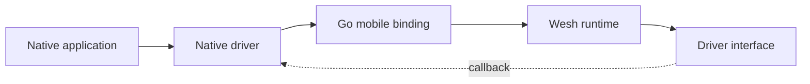

# ADR: Native Drivers for Go Mobile

## Status

Historical design record.

## Context

Mobile applications need to connect native Android and iOS lifecycle APIs to
the Go networking runtime. The Go runtime cannot call platform facilities such
as background-task schedulers directly, while native code still needs a stable
interface that can be exposed through `gomobile` bindings.

## Decision

Define small Go driver interfaces for platform-dependent behavior. Native code
implements the generated protocol, registers the implementation during startup,
and calls back into Go through an explicitly registered handler.



The interface should contain only the operations required by the runtime. It
must not expose application-specific state.

```go
type BackgroundTaskHandler interface {
	HandleTask() bool
}

type BackgroundTaskDriver interface {
	RegisterHandler(BackgroundTaskHandler)
}
```

## Consequences

- Platform code remains outside the portable networking package.
- Bindings expose a small, testable surface instead of an entire native API.
- Driver lifetime and thread-safety must be managed by the embedding app.
- API changes require regenerating and updating both Android and iOS bindings.

## Notes

This record describes an architectural pattern rather than a guaranteed current
API. Check the exported Go interfaces before implementing a new mobile driver.
