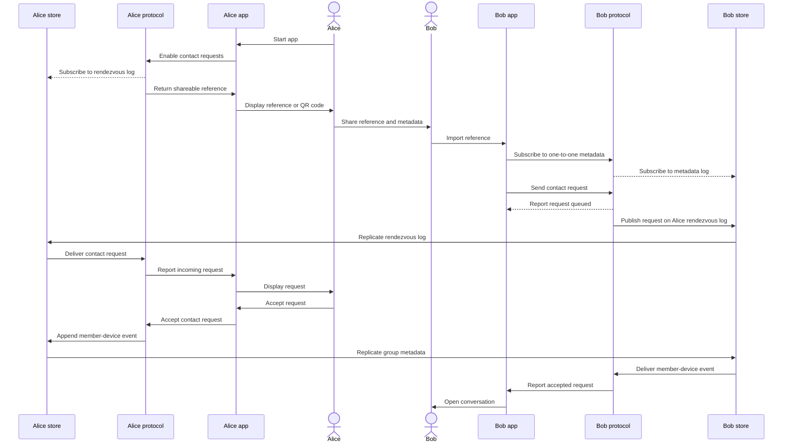

# Messenger MVP Flow

This historical sequence describes the minimum contact-request flow between two
messenger clients. It intentionally omits repeated account-log operations so the
application-visible behavior remains readable.

## Simplifying assumption

In the actual protocol, the application subscribes to its account log and the
protocol appends events to that log. The diagram draws some protocol-to-app
arrows directly instead of showing every append and subscription delivery.

## Contact request

## Security properties

- The shareable reference bootstraps discovery; it is not a substitute for
  authenticated group membership.
- Contact and membership events must be validated before changing local state.
- Applications should make acceptance explicit and identify the requesting
  contact clearly.
- Shared references should be revocable or replaceable when exposure is
  suspected.

For current message and service types, consult the
[generated protocol reference](../apis/protocoltypes.md).
