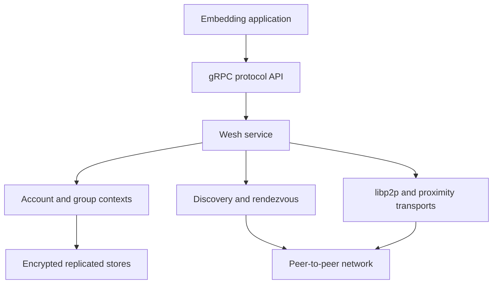

# Architecture Overview

Weshnet separates application behavior from encrypted peer-to-peer networking.
An embedding application talks to the protocol service through generated gRPC
interfaces, while Weshnet manages identity, groups, discovery, transports,
replicated stores, and cryptographic state.

## High-level structure

## Layers

### Protocol API

Definitions in `api/protocol` form the public, language-neutral boundary. The
generated server interface is implemented by the root service package. Internal
protobuf types remain under `api/go-internal`.

### Service lifecycle

The root package constructs persistent or in-memory services, applies network
options, owns shutdown, and coordinates group contexts. Applications should use
the exported service or client interfaces instead of internal packages.

### Identity and secret storage

The secret store owns account, device, group, and chain-key material. Callers
must protect the backing datastore and account exports as sensitive data.

### Group stores

Each active group has metadata and message stores. Metadata events describe
membership and protocol state; message events carry encrypted application
payloads. Replication is authorized by group membership.

### Discovery

The Tinder package coordinates rendezvous drivers, peer caches, and network
notifications. Rotating rendezvous seeds allow a group to replace discovery
material without changing the group itself.

### Networking

libp2p supplies peer identity, streams, pubsub, relays, and transports. Optional
platform drivers add Bluetooth, nearby, or multipeer connectivity without
coupling the core protocol to one application framework.

## Data flow

1. The application calls a generated protocol method.
2. The service validates the request and resolves the account or group context.
3. The operation reads or appends an authenticated event.
4. Replication distributes authorized log entries to connected peers.
5. Protocol streams notify applications of resulting state changes.

## Compatibility boundaries

- Public protobuf definitions affect every generated client.
- Event and store changes may affect persisted data and replication.
- The Go module path includes `/v2` and is part of the public API.
- Internal packages are not compatibility promises.
- Historical ADRs explain prior decisions but may not match current APIs.

## Architecture records

- [Messenger MVP](messenger-mvp.md)
- [Native drivers for Go mobile](adr-gomobile-ipfs.md)
- [Legacy gRPC bridge](adr-grpc-bridge.txt)

For protocol concepts, see the [protocol overview](../protocol.md).
